# Лаборатория: MITRE ATT&CK Chain — 5 техник в одной цепочке атак


## 🎯 Цель работы

Пройти полный путь кибератаки — от разведки до закрепления в системе — используя **5 техник MITRE ATT&CK**. Для каждой техники:

- Выполнить реальную атаку на тестовую инфраструктуру.
- Зафиксировать следы в системных логах Linux.
- Настроить детект в Wazuh SIEM.
- Получить алерт с MITRE-маппингом.

В результате — построить **карту покрытия ATT&CK** и оценить эффективность обнаружения.

## 📚 Теоретическая база

### Что такое MITRE ATT&CK

**MITRE ATT&CK** — база знаний и система классификации действий злоумышленников. Отвечает на вопрос *«Что делает атакующий?»*, а не *«Какая у него уязвимость?»*.

Структура:
- **Tactic (Тактика)** — *почему* (цель атакующего).
- **Technique (Техника)** — *как* (действие).
- **Sub-technique (Подтехника)** — уточнение техники.
- **Procedure (Процедура)** — конкретная реализация.

### Используемые техники

| ID | Название | Тактика | Что делает |
|----|----------|---------|------------|
| **T1046** | Network Service Discovery | Discovery | Сканирование портов |
| **T1110** | Brute Force | Credential Access | Подбор паролей |
| **T1059.004** | Command and Scripting Interpreter: Unix Shell | Execution | Запуск интерпретатора (shell) |
| **T1053.003** | Scheduled Task/Job: Cron | Execution, Persistence, Privilege Escalation | Закрепление через cron |
| **T1082** | System Information Discovery | Discovery | Разведка системы |

### Что такое Wazuh

**Wazuh** — open-source SIEM-система (Security Information and Event Management):
- **Wazuh Manager** — анализирует логи, применяет правила.
- **Wazuh Indexer** — хранит алерты (на базе OpenSearch).
- **Wazuh Dashboard** — визуализация.
- **Wazuh Agent** — устанавливается на хосты, собирает логи.

---

## 📚 Сценарий

Имитация атаки на **Wazuh-сервер** (`192.168.1.95`) с **атакующей VM** (`192.168.1.114`).

### Инфраструктура

| Роль | IP | ОС | Назначение |
|------|-----|-----|-----------|
| Wazuh SIEM (жертва) | `192.168.1.95` | Ubuntu Server 24.04 | Цель атаки + SIEM |
| Атакующий | `192.168.1.114` | Ubuntu Desktop | Машина атакующего |
| Wazuh Dashboard | `https://192.168.1.95` | — | Веб-интерфейс |

### Цепочка атаки

```text
[T1046] Discovery           → Nmap сканирует порты
    ↓
[T1110] Credential Access   → Hydra брутфорсит SSH
    ↓
[T1059.004] Execution       → Запуск shell-интерпретатора на сервере
    ↓
[T1053.003] Persistence     → Cron-задача для закрепления
    ↓
[T1082] Discovery           → Сбор информации о системе
```

---

## 🛠️ Используемые инструменты

| Инструмент | Назначение | Где используется |
|-----------|------------|------------------|
| **Nmap** | Сканирование портов | Атакующая VM |
| **Hydra** | Брутфорс SSH | Атакующая VM |
| **SSH** | Удалённое выполнение команд | Атакующая VM |
| **Cron** | Закрепление в системе | Wazuh-сервер |
| **auditd** | Аудит системных вызовов (`execve`) | Wazuh-сервер |
| **Wazuh** | SIEM, детект, MITRE-маппинг | Wazuh-сервер |
| **UFW** | Firewall (для генерации логов) | Wazuh-сервер |

---

## 📋 Настройка Wazuh

### Кастомные правила

Файл: `/var/ossec/etc/rules/local_rules.xml`

```xml
<!-- ============================================ -->
<!-- T1046 - Network Service Discovery (Port Scan) -->
<!-- ============================================ -->
<group name="mitre,T1046,discovery,">
  <rule id="100100" level="3">
    <program_name>kernel</program_name>
    <match>UFW BLOCK</match>
    <description>UFW: Incoming connection blocked</description>
    <mitre>
      <id>T1046</id>
    </mitre>
  </rule>
</group>

<!-- ============================================ -->
<!-- T1110 - Brute Force (SSH)                    -->
<!-- ============================================ -->
<group name="mitre,T1110,credential_access,">
  <!-- Correlates with built-in rule 5760 (sshd authentication failed) -->
  <!-- Triggers on 5+ failed logins from the same IP within 60 seconds -->
  <rule id="100111" level="10" frequency="5" timeframe="60">
    <if_matched_sid>5760</if_matched_sid>
    <same_source_ip />
    <description>SSH brute force: multiple failed logins from the same IP</description>
    <mitre>
      <id>T1110</id>
    </mitre>
  </rule>
</group>

<!-- ============================================ -->
<!-- T1059.004 - Unix Shell                       -->
<!-- T1082 - System Information Discovery         -->
<!-- ============================================ -->
<group name="mitre,T1059,T1082,execution,discovery,audit,">
  <!-- T1059.004: детектит только запуск shell-интерпретаторов -->
  <rule id="100120" level="5">
    <if_sid>80700</if_sid>
    <field name="audit.key">audit-wazuh-c</field>
    <field name="audit.exe" type="pcre2">/(bash|sh|dash|zsh|ksh|csh)$</field>
    <description>Unix shell execution detected</description>
    <mitre>
      <id>T1059.004</id>
    </mitre>
  </rule>

  <!-- T1082: детектит конкретные discovery-команды (независимо от 100120) -->
  <rule id="100121" level="10">
    <if_sid>80700</if_sid>
    <field name="audit.key">audit-wazuh-c</field>
    <field name="audit.command" type="pcre2">^(whoami|id|uname|hostname|who|w)$</field>
    <description>Discovery command execution detected: $(audit.command)</description>
    <mitre>
      <id>T1082</id>
    </mitre>
  </rule>
</group>

<!-- ============================================ -->
<!-- T1053.003 - Cron (Persistence)               -->
<!-- ============================================ -->
<group name="mitre,T1053.003,persistence,cron,">
  <!-- Correlates with built-in rule 2832 (Crontab entry changed) -->
  <!-- 2832 срабатывает, но не имеет MITRE-маппинга; 100130 его добавляет -->
  <rule id="100130" level="10">
    <if_sid>2832</if_sid>
    <description>Cron persistence detected: crontab modification</description>
    <mitre>
      <id>T1053.003</id>
    </mitre>
  </rule>
</group>
```

📄 Полный файл: [rules/local_rules.xml](rules/local_rules.xml)

### Пояснение к правилам

| Правило | Что делает | Почему так |
|---------|-----------|-----------|
| **100100** | Ловит `UFW BLOCK` | UFW пишет в лог через ядро → `program_name=kernel` |
| **100111** | Корреляция 5+ неудачных логинов за 60 сек | Наследует от стандартного `5760`. `<same_source_ip />` группирует по IP |
| **100120** | Ловит запуск **shell-интерпретаторов** (bash, sh, dash, zsh, ksh, csh) → T1059.004 | Наследует от `80700`. Проверяет `audit.key` + `audit.exe` через regex |
| **100121** | Ловит **конкретные** discovery-команды → T1082 | Наследует напрямую от `80700` (независимо от `100120`). Regex с якорями `^...$` |
| **100130** | Детектит изменение crontab → T1053.003 | Наследует от стандартного `2832` и добавляет MITRE-маппинг |

> **Почему `100121` не наследует от `100120`:** `100120` матчит **только shell-интерпретаторы**. Команда `whoami` — не shell, поэтому если бы `100121` наследовал от `100120`, он бы не срабатывал на discovery-команды. Поэтому `100121` наследует **напрямую от `80700`**.

> **Почему только `T1059.004`:** `T1059.004 (Unix Shell)` — это `bash`, `sh`, `dash`, `zsh`, `ksh`, `csh`. Python — это `T1059.006`, Perl — отдельной подтехники нет. В лабораторной мы покрываем только shell. Явный список шеллов в regex соответствует описанию подтехники на MITRE.

> **Про `100121` и `audit.command`:** правило использует якоря `^...$` — они работают, если `audit.command` содержит короткое имя команды (`whoami`). В текущей версии Wazuh (`4.9.2`) поле именно такое. Если в другой версии `audit.command` начнёт содержать полный путь (`/usr/bin/whoami`) — якоря не сработают, потребуется скорректировать regex.

### Сбор логов

Файл: `/var/ossec/etc/ossec.conf`

```xml
<!-- SSH + sudo via journald (с фильтром) -->
<localfile>
  <log_format>journald</log_format>
  <location>journald</location>
  <filter field="_SYSTEMD_UNIT">^ssh\.service$</filter>
  <filter field="_SYSTEMD_UNIT">^sudo\.service$</filter>
</localfile>

<!-- UFW -->
<localfile>
  <log_format>syslog</log_format>
  <location>/var/log/ufw.log</location>
</localfile>

<!-- Audit (command execution) -->
<localfile>
  <log_format>audit</log_format>
  <location>/var/log/audit/audit.log</location>
</localfile>

<!-- SSH: auth.log как fallback -->
<localfile>
  <log_format>syslog</log_format>
  <location>/var/log/auth.log</location>
</localfile>

<!-- Cron: /var/log/syslog -->
<localfile>
  <log_format>syslog</log_format>
  <location>/var/log/syslog</location>
</localfile>
```

> **⚠️ Про выбор источников для SSH — два источника одновременно:**
>
> При тестировании на **Ubuntu 24.04 + Wazuh 4.9.2** обнаружено, что `journald` reader для sshd-событий ведёт себя **асимметрично**:
> - **`Failed password` (5760)** — корректно читается из `journald`.
> - **`Accepted password` (5715)** — **не всегда** доходит через `journald`.
>
> Поэтому в конфиге **два источника для SSH**: `journald` с фильтром `_SYSTEMD_UNIT=ssh.service|sudo.service` и `/var/log/auth.log`. `journald` даёт мгновенную доставку событий `5760`; `auth.log` подстраховывает `5715`.
>
> **Проверка дублей:** `uniq -c` по `full_log` в `alerts.json` показывает `count = 1` для каждого события. Wazuh **дедуплицирует** одинаковые события из разных источников — дубли отсутствуют.

> **⚠️ Почему фильтр по `_SYSTEMD_UNIT` критичен:** без него journald reader захватывает **все** системные события — шум от ядра, других служб, kernel-логов. С фильтром Wazuh получает **только** события от `ssh.service` и `sudo.service` — именно то, что нужно для правил `5715`, `5760`, `100120`, `100121`.

> **⚠️ Про `/var/log/syslog` для cron:** cron-события (`crontab[pid]: (testuser) REPLACE`) пишутся в `/var/log/syslog` через rsyslog. Это **единственный источник** для правила `100130` — journald с фильтром `ssh|sudo` его не покрывает. Проверено: без блока `syslog` правило `100130` не срабатывает.

> **✅ Проверка работы:**
> - `5715` (authentication success) — работает ✅
> - `5760` (authentication failed) — 8 hits за атаку, без дублей ✅
> - `100111` (brute force) — корреляция срабатывает корректно ✅
> - `100130` (cron persistence) — работает ✅

### Настройка auditd

**Зачем нужен auditd:** стандартный Wazuh **не детектит конкретные команды**. `auditd` перехватывает системный вызов `execve` и пишет в `/var/log/audit/audit.log`. Wazuh читает этот лог и детектит команды.

Файл: `/etc/audit/rules.d/wazuh.rules`

```text
-a exit,always -F euid=1001 -F arch=b64 -S execve -k audit-wazuh-c
-a exit,always -F euid=1001 -F arch=b32 -S execve -k audit-wazuh-c
```

📄 Полный файл: [auditd/wazuh.rules](auditd/wazuh.rules)

**Разбор:**
- `-a exit,always` — срабатывать всегда при выходе из syscall.
- `-F euid=1001` — фильтр по эффективному UID (`testuser`).
- `-F arch=b64/b32` — для 64- и 32-битных процессов.
- `-S execve` — системный вызов выполнения программы.
- `-k audit-wazuh-c` — ключ (метка), по которому Wazuh распознаёт событие.

> **⚠️ Про `euid=1001`:** значение `1001` — **фактический UID пользователя `testuser`** в лабораторной системе. Проверить: `id testuser`. Если в вашей системе UID отличается — заменить его в `/etc/audit/rules.d/wazuh.rules` и перезагрузить правила через `augenrules --load`.

**Применение (постоянное):**
```bash
# Загрузить правила и сделать постоянными
sudo augenrules --load

# Проверить, что загружены
sudo auditctl -l | grep audit-wazuh-c
```

> **Важно:** команда `auditctl -R` загружает правила **временно** (до перезагрузки). Для постоянного применения используется `augenrules --load`.

> **Про `audit.log` — два типа событий:** файл содержит **и дефолтные PAM-события** (`USER_AUTH`, `USER_LOGIN`, `USER_ACCT`), которые auditd пишет автоматически, **и кастомные `execve`-события** с ключом `audit-wazuh-c` от `testuser`. Кастомные правила `100120`/`100121` реагируют **только на второй тип**. PAM-события — отдельный слой детекта, в лабораторной не покрыт. Это объясняет, почему в `audit.log` может быть больше событий об аутентификации, чем в дашборде Wazuh по `rule.id: 5760`.

### Применение всех настроек

```bash
sudo systemctl restart wazuh-manager
sudo systemctl restart wazuh-agent
sudo systemctl status wazuh-manager
```

### Проверка правил через `wazuh-logtest`

Перед тем как генерировать реальные события, правила нужно протестировать. `wazuh-logtest` — встроенный инструмент для проверки, как Wazuh обработает лог.

```bash
sudo /var/ossec/bin/wazuh-logtest
```

**Пример для проверки `100121`** (discovery-команда):

```
type=SYSCALL msg=audit(1790541812.878:276): arch=c000003e syscall=59 success=yes exit=0 items=2 ppid=30449 pid=30500 auid=1001 uid=1001 gid=1001 euid=1001 suid=1001 fsuid=1001 egid=1001 sgid=1001 fsgid=1001 tty=pts1 ses=6 comm="whoami" exe="/usr/bin/whoami" subj=unconfined key="audit-wazuh-c"
```

**Ожидаемый результат:**
```
**Phase 3: Completed filtering (rules).
        id: '100121'
        mitre.id: '['T1082']'
        mitre.tactic: '['Discovery']'
**Alert to be generated.
```

**Пример для проверки `100120`** (shell-интерпретатор):

```
type=SYSCALL msg=audit(1790541812.878:276): arch=c000003e syscall=59 success=yes exit=0 items=2 ppid=30449 pid=30500 auid=1001 uid=1001 gid=1001 euid=1001 suid=1001 fsuid=1001 egid=1001 sgid=1001 fsgid=1001 tty=pts1 ses=6 comm="bash" exe="/usr/bin/bash" subj=unconfined key="audit-wazuh-c"
```

**Ожидаемый результат:**
```
**Phase 3: Completed filtering (rules).
        id: '100120'
        mitre.id: '['T1059.004']'
        mitre.tactic: '['Execution']'
        mitre.technique: '['Unix Shell']'
**Alert to be generated.
```

**Проверка UFW-лога** (для правила `100100`):

```
Sep 25 15:52:08 wazuh-server kernel: [UFW BLOCK] IN=enp0s3 OUT= SRC=192.168.1.114 DST=192.168.1.95 ... DPT=80 ...
```

**Результат:**
```
**Phase 2: Completed decoding.
        name: 'kernel'
**Phase 3: Completed filtering (rules).
        id: '100100'
        mitre.id: '['T1046']'
**Alert to be generated.
```

> **Замечание:** `wazuh-logtest` **не извлекает `srcip`** из UFW-логов (видно только `name: 'kernel'`). Это подтверждает ограничение: корреляционное правило `<same_source_ip />` для UFW не работает без кастомного декодера.

**Проверка cron-лога** (для правила `100130`):

```
2026-09-29T15:49:52.506767+00:00 wazuh-server crontab[30043]: (testuser) REPLACE (testuser)
```

**Результат:**
```
**Phase 2: Completed decoding.
        No decoder matched.
**Phase 3: Completed filtering (rules).
        id: '100130'
        mitre.id: '['T1053.003']'
**Alert to be generated.
```

> **Пояснение:** `No decoder matched` означает лишь, что **поля не извлечены** (нет `srcuser`, `command`). Правило `2832` матчится по `program_name=crontab` и ключевому слову `REPLACE` — декодер для этого не обязателен. `100130` наследует от `2832` и добавляет MITRE-маппинг. **Проверено** — каскад `2832 → 100130` срабатывает корректно, несмотря на `No decoder matched`.

---

## 📖 Ход работы

### ✅ Шаг 1. T1046 — Network Service Discovery

**Тактика:** Discovery (`TA0007`)

#### Что делали

Сканирование портов Wazuh-сервера с атакующей VM. Это **первый этап любой атаки** — разведка. Злоумышленник выясняет, какие сервисы открыты и какие версии используются.

```bash
nmap -sV -p 22,80,443,3306,3389 192.168.1.95
```

**Разбор команды:**
- `-sV` — определение версий сервисов (Version detection).
- `-p 22,80,443,3306,3389` — сканирование популярных портов (SSH, HTTP, HTTPS, MySQL, RDP).
- `192.168.1.95` — IP цели.

#### Результат сканирования

```text
Starting Nmap 7.80 ( https://nmap.org ) at 2026-09-25 18:09 MSK
Nmap scan report for wazuh-server (192.168.1.95)
Host is up (0.010s latency).

PORT     STATE     SERVICE       VERSION
22/tcp   open      ssh           OpenSSH 9.6p1 Ubuntu 3ubuntu13.19
80/tcp   filtered  http
443/tcp  open      ssl/https     Wazuh Dashboard
3306/tcp filtered  mysql
3389/tcp filtered  ms-wbt-server

Nmap done: 1 IP address (1 host up) scanned in 21.11 seconds
```

**Разбор результата:**

| Порт | Состояние | Что значит |
|------|-----------|------------|
| 22/tcp | open | SSH-сервер открыт — цель для брутфорса |
| 80/tcp | filtered | UFW блокирует HTTP-пакеты |
| 443/tcp | open | Wazuh Dashboard — точка входа |
| 3306/tcp | filtered | UFW блокирует MySQL |
| 3389/tcp | filtered | UFW блокирует RDP |

**Состояния портов Nmap:**
- **`open`** — сервис принимает подключения.
- **`closed`** — порт доступен, но сервис не слушает.
- **`filtered`** — пакеты блокируются firewall (UFW), ответ не приходит.

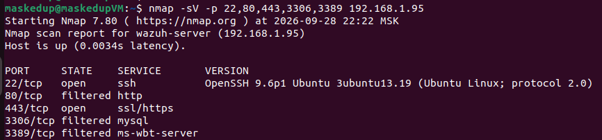

*Рис. 1. Результат сканирования Nmap: открыты порты 22 и 443, остальные фильтруются UFW.*

#### Детект Wazuh

**Что произошло в логах:**
1. UFW (Uncomplicated Firewall) блокирует входящие соединения на закрытые порты.
2. Каждый заблокированный пакет → запись `[UFW BLOCK]` в `/var/log/ufw.log`.
3. Wazuh Logcollector читает `ufw.log`.
4. Wazuh Analysisd применяет правило `100100`.
5. Создаётся алерт с MITRE-маппингом.

**Алерты в Wazuh Dashboard:**

| Rule ID | Level | Description | MITRE |
|---------|-------|-------------|-------|
| 100100 | 3 | UFW: Incoming connection blocked | T1046 |

**Поля алерта:**

```text
rule.groups:              mitre, T1046, discovery
rule.id:                  100100
rule.level:               3
rule.mitre.id:            T1046
rule.mitre.tactic:        Discovery
rule.mitre.technique:     Network Service Discovery
decoder.name:             kernel
location:                 /var/log/ufw.log
```

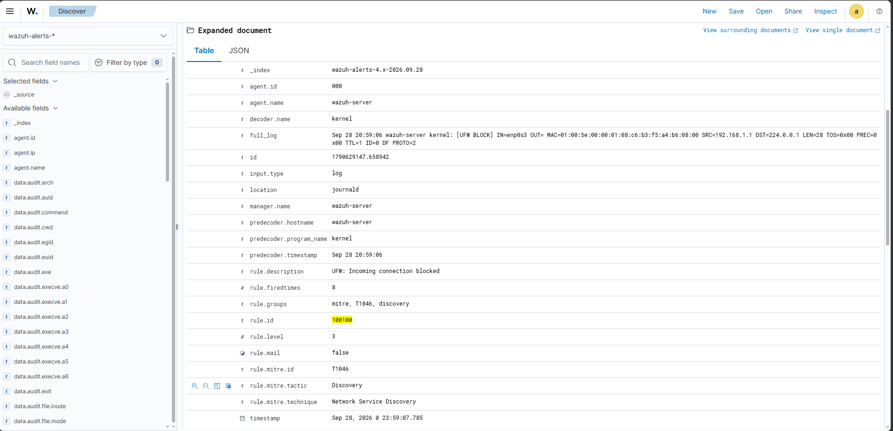

*Рис. 2. Алерт Wazuh на сканирование портов: T1046 (Network Service Discovery).*

#### Выводы по шагу 1

1. Nmap успешно обнаружил открытые порты (22, 443) и заблокированные (80, 3306, 3389).
2. UFW корректно работает — блокирует входящие на закрытые порты и логирует.
3. Wazuh задетектил **каждое заблокированное соединение** через правило `100100`. Корреляция множественных блокировок в одно событие «Port scan» требует кастомного декодера (не реализовано в данной версии).
4. MITRE-маппинг работает — алерт получил `T1046` и тактику `Discovery`.
5. **Ограничение:** для работы корреляционного правила `<same_source_ip />` с логами UFW требуется кастомный декодер, так как стандартный декодер Wazuh не извлекает `srcip` из UFW-логов.

---

### ✅ Шаг 2. T1110 — Brute Force (SSH)

**Тактика:** Credential Access (`TA0006`)

#### Что делали

Брутфорс SSH через Hydra с атакующей VM. Злоумышленник **знает**, что на сервере открыт SSH (из Шага 1) и пытается подобрать пароль root.

```bash
echo -e "123456\npassword\nadmin\nqwerty\nroot\nletmein\ntoor\nadmin123\n12345678\nqwerty123" > pass.txt
hydra -l root -P pass.txt ssh://192.168.1.95 -t 10 -W 2
```

**Разбор команды:**
- `-l root` — атакуемый пользователь.
- `-P pass.txt` — словарь из 10 паролей.
- `ssh://192.168.1.95` — цель.
- `-t 10` — 10 параллельных потоков (по числу паролей).
- `-W 2` — задержка **2 секунды между соединениями** (не между попытками паролей).

#### Результат Hydra

```text
Hydra v9.2 (c) 2021 by van Hauser/THC & David Maciejak
[DATA] max 10 tasks per 1 server, overall 10 tasks, 10 login tries (l:1/p:10), ~1 try per task
[DATA] attacking ssh://192.168.1.95:22/
[WARNING] Many SSH configurations limit the number of parallel tasks,
it is recommended to reduce the tasks: use -t 4
1 of 1 target completed, 0 valid password found
Hydra (https://github.com/vanhauser-thc/thc-hydra) finished
```

**Пароль не подобран** — это ожидаемый результат (сложный пароль root). Цель — сгенерировать попытки для детекта.

**Про число событий в дашборде:** словарь содержит 10 паролей, Hydra запускает 10 параллельных потоков (`-t 10`). Однако в дашборде `rule.id: 5760` за Last 5 minutes видно **8 hits**. Причина — **`MaxStartups`** в `sshd_config`: sshd отбрасывает часть одновременных соединений **до стадии проверки пароля**, поэтому они не попадают в `auth.log` и не детектятся.

**Проверено:** изменение `-W 1` → `-W 2` **не влияет** на число hits (8 остаётся). Флаг `-W` регулирует задержку между соединениями **одной задачи**, но при `-t 10` все 10 задач стартуют **одновременно** — задержка не работает. Реальное число дошедших событий зависит от `MaxStartups`, а не от `-W`.

Дублирование логов **исключено** — проверено через `uniq -c` по `full_log` в `alerts.json` (`count = 1` для каждого события).

Для детекта это не критично: корреляционному правилу `100111` достаточно **5 событий за 60 секунд**.

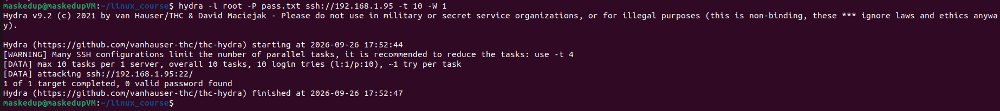

*Рис. 3. Вывод Hydra: 10 попыток брутфорса, пароль не подобран.*

#### Детект Wazuh

**Что произошло в логах:**
1. SSH-сервер фиксирует каждую неудачную попытку в `journald` (unit `ssh.service`) и в `/var/log/auth.log`.
2. Wazuh Logcollector читает **оба источника**:
   - `journald` с фильтром `_SYSTEMD_UNIT=ssh.service` — мгновенная доставка.
   - `auth.log` — fallback для событий `5715`.
3. Wazuh применил **стандартное** правило `5760` на каждую попытку → **8 hits** за атаку (в окне Last 5 minutes). Дубли отсутствуют — Wazuh дедуплицирует одинаковые события из двух источников.
4. Кастомное правило `100111` сработало **2 раза** — события `5760` распределились по двум 60-секундным окнам, каждое получило 5+ событий.

**Алерты в Wazuh Dashboard (Last 5 minutes):**

| Rule ID | Level | Hits | Description | MITRE |
|---------|-------|------|-------------|-------|
| 5760 | 5 | 8 | sshd: authentication failed | T1110.001, T1021.004 |
| 100111 | 10 | 2 | SSH brute force: multiple failed logins from the same IP | T1110 |

> **Про маппинг `5760`:** стандартное правило Wazuh 4.9.2 мапит `sshd: authentication failed` на два MITRE-ID: `T1110.001 (Password Guessing)` и `T1021.004 (Remote Services: SSH)`. Маппинг на `T1021.004` для **неудачной** аутентификации спорен, но это поведение дефолтного ruleset — мы его не переопределяем.

> **Про `rule.firedtimes`:** поле в Wazuh — это **счётчик срабатываний правила** с момента **последнего сброса**. Сброс происходит **при перезапуске `wazuh-manager`**, а также **при обновлении почасовой статистики в `wazuh-analysisd`** (грубо говоря, **раз в час**). В `wazuh-logtest` **счётчик не сбрасывается в течение всей сессии**. В скриншотах `firedtimes: 9, 10, 11...` — это **накопленные цифры с последнего сброса**, а **не «за всё время наблюдения»** и **не за одну Hydra-сессию**.

**Поля алерта `5760` (стандартное):**

```text
rule.groups:              syslog, sshd, authentication_failed
rule.id:                  5760
rule.level:               5
rule.mitre.id:            T1110.001, T1021.004
rule.mitre.tactic:        Credential Access, Lateral Movement
rule.mitre.technique:     Password Guessing, SSH
data.srcip:               192.168.1.114
data.dstuser:             root
location:                 journald
```

**Поля алерта `100111` (корреляционное):**

```text
rule.groups:              mitre, T1110, credential_access
rule.id:                  100111
rule.level:               10
rule.frequency:           5
rule.mitre.id:            T1110
rule.mitre.tactic:        Credential Access
rule.mitre.technique:     Brute Force
data.srcip:               192.168.1.114
data.dstuser:             root
previous_output:          <список 4+ предыдущих попыток>
location:                 journald
```

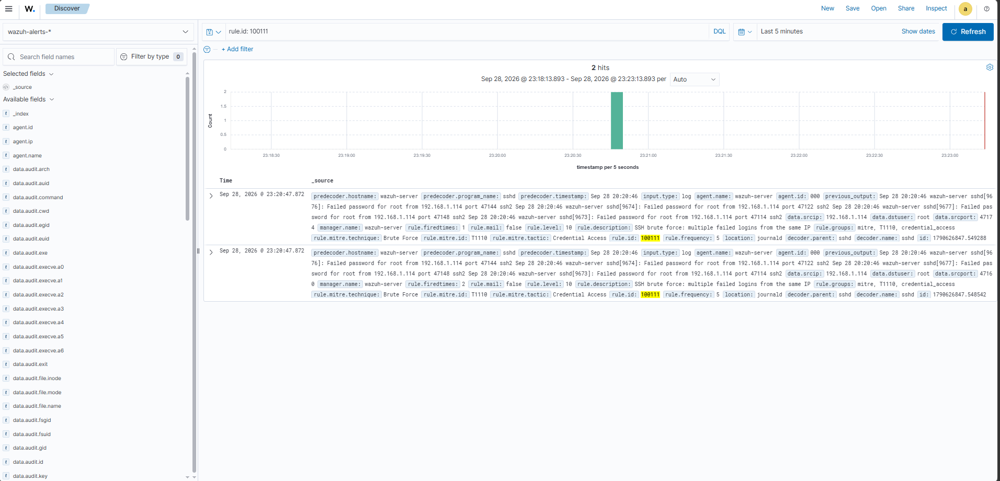

*Рис. 4a. Алерт Wazuh на SSH-брутфорс: T1110 (Brute Force), Credential Access — 2 correlation hits.*

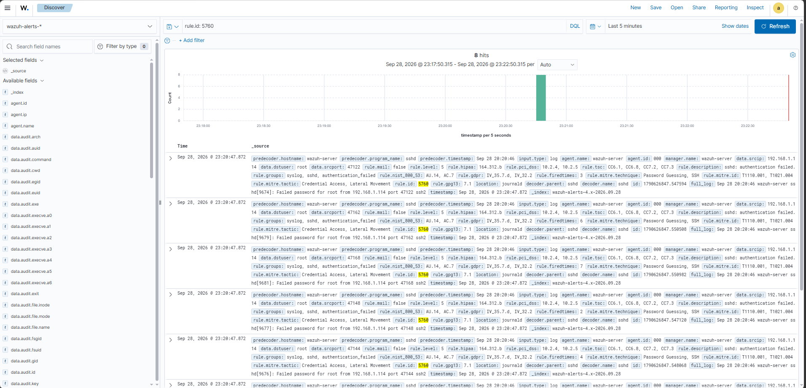

*Рис. 4b. Сырые события `5760` за одну атаку Hydra — 8 hits.*

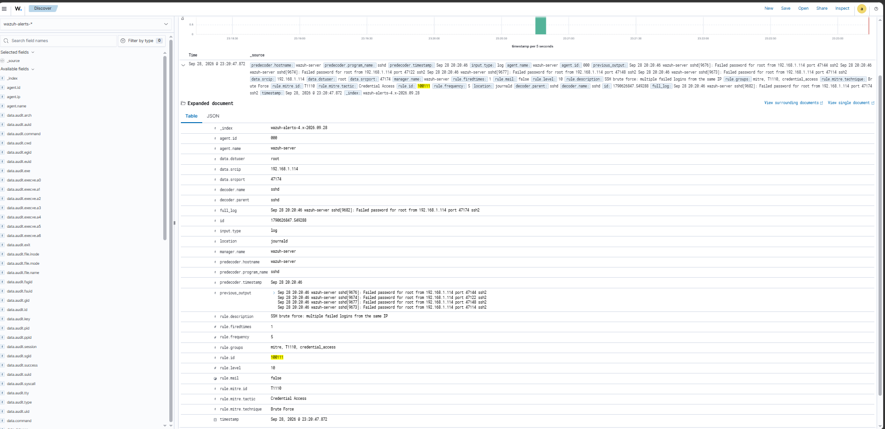

*Рис. 4c. Детали алерта `100111`: `previous_output` содержит список 4+ предыдущих попыток, `mitre.id=T1110`, `location=journald`.*

#### Выводы по шагу 2

1. Hydra сгенерировала 10 попыток входа, пароль не подобран.
2. **Стандартное правило `5760` детектит каждую неудачную попытку SSH-аутентификации** и мапит её на `T1110.001 (Password Guessing)`. Это **не брутфорс**, а одиночное событие.
3. **Корреляционное правило `100111`** объединило 5+ попыток в один агрегированный алерт «SSH brute force». За атаку: **2 correlation alert** — события `5760` распределились по двум 60-секундным окнам.
4. MITRE-маппинг работает на двух уровнях:
   - Стандартное правило: `T1110.001 (Password Guessing)` — точная техника.
   - Корреляционное правило: `T1110 (Brute Force)` — общая техника.
5. Поле `previous_output` в алерте `100111` содержит **список предыдущих попыток** — это **ключевое отличие корреляционного алерта** от одиночного. Аналитик видит всю картину, а не одно событие.
6. **Про число событий:** словарь содержал 10 паролей, в дашборде `5760` видно 8 hits. Причина — `MaxStartups` в `sshd_config`: часть одновременных соединений sshd отбрасывает до стадии проверки пароля. `-W 1` и `-W 2` дают одинаковый результат (8 hits) — это доказывает, что дело в sshd, а не в Hydra.

---

### ✅ Шаг 3. T1059.004 — Command and Scripting Interpreter: Unix Shell

**Тактика:** Execution (`TA0002`)

#### Что делали

Запуск shell-интерпретатора на скомпрометированном сервере через SSH. Имитация ситуации, когда злоумышленник **получил доступ** и выполняет команды через shell.

Сначала на Wazuh-сервере создан тестовый пользователь:

```bash
sudo useradd -m testuser
sudo passwd testuser
```

Затем с атакующей VM выполнены команды через SSH:

```bash
ssh testuser@192.168.1.95 "whoami && id && uname -a"
```

**Разбор команды:**
- `ssh testuser@192.168.1.95` — подключение к серверу.
- `"whoami && id && uname -a"` — команды для сбора информации о системе.

#### Результат выполнения

```text
testuser
uid=1001(testuser) gid=1001(testuser) groups=1001(testuser)
Linux wazuh-server 6.8.0-142-generic #142-Ubuntu SMP PREEMPT_DYNAMIC Wed Sep 2 14:24:27 UTC 2026 x86_64 GNU/Linux
```

**Что это значит:**
- `whoami` → `testuser` — текущий пользователь.
- `id` → `uid=1001(testuser)` — идентификатор пользователя.
- `uname -a` → информация об ОС, ядре, архитектуре.

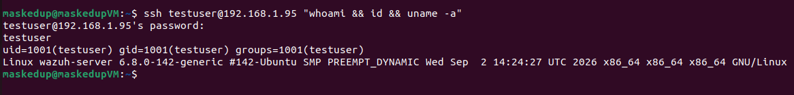

*Рис. 5. Выполнение команд через SSH: whoami, id, uname -a на скомпрометированном сервере.*

#### Детект Wazuh

**Что произошло в логах:**
1. SSH-сервер зафиксировал успешный вход в `/var/log/auth.log` → правило `5715`.
2. **`auditd`** перехватил системный вызов `execve` для каждой команды → записал в `/var/log/audit/audit.log`.
3. Wazuh прочитал оба источника и применил правила:
   - **`5715`** (стандартное) — успешный SSH-вход (T1078, T1021).
   - **`100121`** (кастомное) — детект **discovery-команды** (`whoami`, `id`, `uname`) → T1082.
   - **`100120`** (кастомное) — **не срабатывает** на `whoami`, потому что `whoami` — не shell-интерпретатор. Правило сработает только на `bash`, `sh`, `dash`, `zsh`, `ksh`, `csh`.

**Алерты в Wazuh Dashboard:**

| Rule ID | Level | Description | MITRE |
|---------|-------|-------------|-------|
| 5715 | 3 | sshd: authentication success | T1078, T1021 |
| 100121 | 10 | Discovery command execution detected: whoami | T1082 |

**Поля алерта `100121`:**

```text
rule.id:                  100121
rule.description:         Discovery command execution detected: whoami
rule.mitre.id:            T1082
rule.mitre.tactic:        Discovery
rule.mitre.technique:     System Information Discovery
audit.command:            whoami
audit.key:                audit-wazuh-c
audit.exe:                /usr/bin/whoami
audit.euid:               1001
location:                 /var/log/audit/audit.log
```

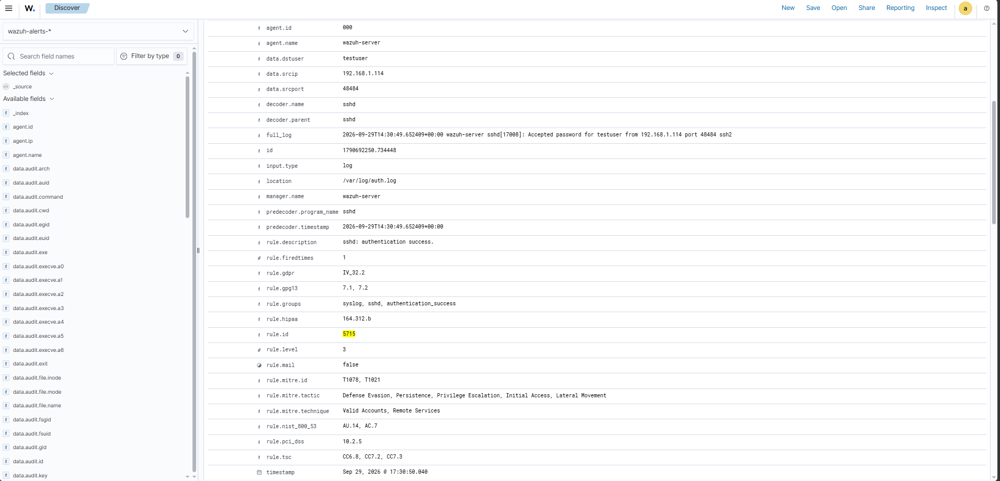

*Рис. 6a. Алерт Wazuh на успешный SSH-вход: T1078 (Valid Accounts), T1021 (Remote Services).*

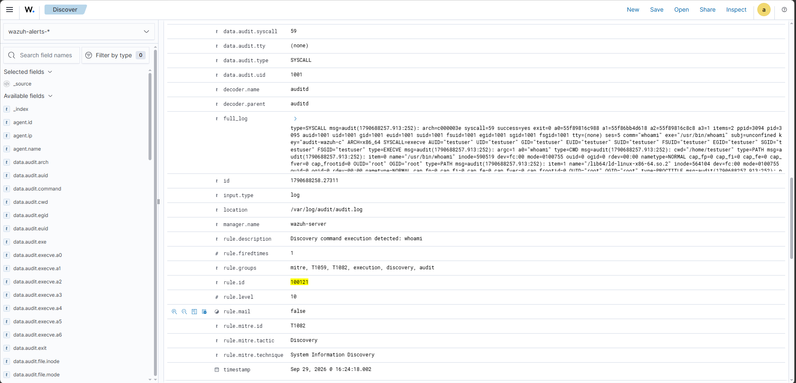

*Рис. 6b. Алерт Wazuh на выполнение discovery-команд: T1082 (System Information Discovery).*

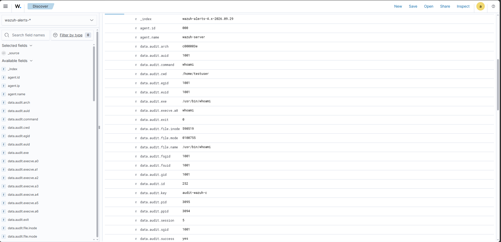

*Рис. 6c. Детали алерта: audit.command=whoami, audit.exe=/usr/bin/whoami, audit.key=audit-wazuh-c.*

#### Выводы по шагу 3

1. Злоумышленник получил доступ к серверу под учётной записью `testuser`.
2. Выполнены команды разведки: `whoami`, `id`, `uname -a`.
3. Wazuh задетектил:
   - **Факт входа** — правило `5715` (T1078, T1021).
   - **Конкретные команды** — правило `100121` через `auditd` (T1082).
4. **Техника T1059.004 (Unix Shell)** — покрыта правилом `100120`, которое срабатывает **только на запуск shell-интерпретаторов** (`bash`, `sh`, `dash`, `zsh`, `ksh`, `csh`). Правило **не мапит** на T1059 обычные команды вроде `whoami`.
5. **Техника T1082 (System Information Discovery)** — покрыта правилом `100121` (discovery-команды).
6. **Ключевой момент:** `auditd` позволяет детектить **конкретные команды**, а не только факт входа. Без него Wazuh видит только `sshd: authentication success`.

---

### ✅ Шаг 4. T1053.003 — Cron (Persistence)

**Тактика:** Execution, Persistence, Privilege Escalation (`TA0002`, `TA0003`, `TA0004`)

#### Что делали

Создание cron-задачи для закрепления в системе (имитация **persistence** после компрометации). Злоумышленник хочет, чтобы его код выполнялся автоматически даже после перезагрузки.

```bash
# Создаём cron-задачу от имени testuser
sudo -u testuser bash -c 'echo "*/5 * * * * /bin/bash -c \"echo test >> /tmp/attck.log\"" | crontab -'

# Проверяем
sudo -u testuser crontab -l
```

**Разбор команды:**
- `sudo -u testuser` — выполняем от имени скомпрометированного пользователя.
- `crontab -` — читает задания из stdin и устанавливает их.
- `*/5 * * * *` — запуск **каждые 5 минут** (`*/5` = каждая 5-я минута часа; остальные `*` — каждый час, день, месяц, день недели).
- `/bin/bash -c "echo test >> /tmp/attck.log"` — полезная нагрузка.

#### Результат создания задачи

```text
*/5 * * * * /bin/bash -c "echo test >> /tmp/attck.log"
```

**Проверка выполнения (через 5–10 минут):**

```bash
sudo cat /tmp/attck.log
```

```text
test
test
test
...
```

> **Примечание:** Cron срабатывает каждые 5 минут, закрепление работает.

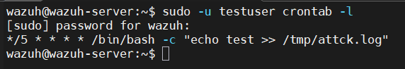

*Рис. 7a. Закрепление через cron (T1053.003): создана задача от имени testuser.*

#### Детект Wazuh

**Что произошло в логах:**
1. Команда `crontab` изменила задачу от имени `testuser`.
2. В `/var/log/syslog` появилась запись:
   ```
   2026-09-29T15:49:52.506767+00:00 wazuh-server crontab[30043]: (testuser) REPLACE (testuser)
   ```
3. **Проверка через `wazuh-logtest`** (с временно закомментированным `100130`): стандартное правило `2832` (Crontab entry changed) **срабатывает** — оно матчит лог по `program_name=crontab` и ключевому слову `REPLACE`. Декодер поля не извлекает (`No decoder matched`), но **для срабатывания правила это не обязательно**.
4. Однако у `2832` **нет MITRE-маппинга** на `T1053.003`.
5. Кастомное правило `100130` **наследует** от `2832` через `<if_sid>` и **добавляет MITRE-маппинг**.

**Алерт в Wazuh Dashboard:**

| Rule ID | Level | Description | MITRE |
|---------|-------|-------------|-------|
| 100130 | 10 | Cron persistence detected: crontab modification | T1053.003 |

> **Примечание:** родительское правило `2832` (level 5) срабатывает, но его алерт **перекрывается дочерним `100130`** (level 10) — в `alerts.json` сохраняется только финальное правило каскада с полным MITRE-маппингом. Это стандартное поведение Wazuh: дочерние правила (`<if_sid>`) подавляют родительские.

**Поля алерта `100130`:**

```text
rule.groups:              mitre, T1053.003, persistence, cron
rule.id:                  100130
rule.level:               10
rule.mitre.id:            T1053.003
rule.mitre.tactic:        Execution, Persistence, Privilege Escalation
rule.mitre.technique:     Cron
full_log:                 2026-09-29T15:49:52.506767+00:00 wazuh-server crontab[30043]: (testuser) REPLACE (testuser)
location:                 /var/log/syslog
```

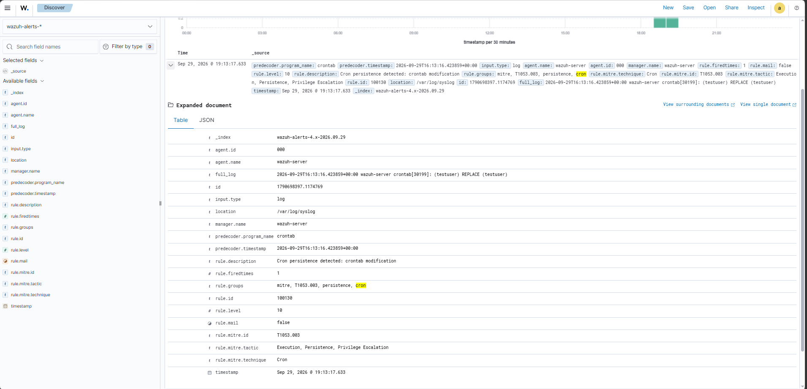

*Рис. 7b. Алерт Wazuh на изменение crontab: T1053.003 (Scheduled Task/Job: Cron).*

#### Выводы по шагу 4

1. Злоумышленник создал cron-задачу от имени `testuser` для закрепления.
2. Cron выполняется каждые 5 минут — записывает `test` в `/tmp/attck.log`.
3. **Стандартное правило `2832` срабатывает** на Ubuntu 24.04 — оно матчит лог по `program_name=crontab` и ключевому слову `REPLACE`. Декодер поля не извлекает, но это не мешает детекту.
4. **Однако у `2832` нет MITRE-маппинга** на `T1053.003`. Кастомное правило `100130` **наследует** от `2832` и **добавляет** маппинг.
5. **Паттерн «наследование правил»:** кастомное правило с `<if_sid>` от стандартного — правильный способ добавить MITRE-маппинг, не переписывая базовое правило.
6. **Про интервал `*/5`:** выбран для удобства демонстрации (лог растёт медленнее, чем при `* * * * *`). На детект это **не влияет** — Wazuh ловит **факт изменения crontab** (`REPLACE` в syslog), а не частоту выполнения задачи. В реальной атаке злоумышленник может использовать любой интервал.

---

### ✅ Шаг 5. T1082 — System Information Discovery

**Тактика:** Discovery (`TA0007`)

**Примечание:** Техника T1082 покрыта правилом `100121` из Шага 3. Команды `whoami`, `id`, `uname -a` матчатся регуляркой и создают алерт с MITRE-маппингом на `T1082`.

**Алерты в Wazuh Dashboard:**

| Rule ID | Level | Description | MITRE |
|---------|-------|-------------|-------|
| 100121 | 10 | Discovery command execution detected: whoami | T1082 |

#### Выводы по шагу 5

1. Команды разведки системы (`whoami`, `id`, `uname`) — это типичные команды T1082.
2. Wazuh задетектил их через `auditd` + правило `100121`.
3. **Ключевой момент:** одна и та же команда может относиться к нескольким техникам:
   - `whoami` → T1082 (Discovery).
   - `bash -c "..."` → T1059.004 (Unix Shell).
   Разница в том, **что именно запущено**: shell-интерпретатор или конкретная утилита.

---

## 📊 Карта покрытия

| Шаг | Техника | Тактика | Инструмент | Rule ID | Статус |
|-----|---------|---------|------------|---------|--------|
| 1 | T1046 | Discovery | Nmap | 100100 | ✅ Full |
| 2 | T1110 | Credential Access | Hydra | 5760, 100111 | ✅ Full |
| 3 | T1059.004 | Execution | SSH + auditd | 100120 | ✅ Full |
| 4 | T1053.003 | Execution, Persistence, Privilege Escalation | Cron | 100130 | ✅ Full |
| 5 | T1082 | Discovery | Shell + auditd | 100121 | ✅ Full |

**Покрытие: 5 из 5 техник (100%).**

## 🛡️ Меры защиты (Mitigations)

| Техника | Мера |
|---------|------|
| **T1046** | Закрыть ненужные порты, использовать firewall (UFW), ограничить доступ по IP |
| **T1110** | Сложные пароли, MFA, блокировка аккаунта после N попыток, ключи вместо паролей |
| **T1059.004** | Ограничить SSH-доступ по IP, использовать ключи, аудит команд (auditd) |
| **T1053.003** | Мониторинг cron-задач, ограничить права на crontab, alert на новые задачи |
| **T1082** | Минимизировать информацию в баннерах, ограничить доступ, аудит команд |

## 🎓 Выводы

В ходе лабораторной работы:

1. **Пройдена полная цепочка из 5 техник MITRE ATT&CK** — от разведки (T1046) до закрепления (T1053.003).

2. **Развёрнут Wazuh SIEM** с кастомными правилами и MITRE-маппингом.

3. **Настроен auditd** для аудита выполнения команд (`execve`) — это позволило задетектить **конкретные команды**, а не только факт входа.

4. **Покрытие детекта — 100%** (5 из 5 техник).

5. **Ключевые находки:**
   - Wazuh из коробки мапит **одиночную неудачную SSH-аутентификацию** (`5760` → T1110.001) и **успешный SSH-вход** (`5715` → T1078, T1021).
   - **Стандартные правила не покрывают:** Nmap-сканирование (T1046), запуск shell-интерпретаторов (T1059.004), изменение crontab (T1053.003) с MITRE-маппингом.
   - **Кастомные правила** закрыли эти пробелы.

6. **Паттерн «наследование правил»:** кастомное правило с `<if_sid>` от стандартного — правильный способ добавить MITRE-маппинг, не переписывая базовое правило. Пример: `100130` наследует от `2832`.

7. **Разделение техник:** `100120` детектит **только shell-интерпретаторы** (T1059.004), `100121` — **discovery-команды** (T1082). Это соответствует методологии MITRE.

8. **Проверка через `wazuh-logtest`** — обязательный шаг. Без него нельзя утверждать, что правило работает: тесты показали, что UFW-декодер не извлекает `srcip`, а `2832` срабатывает без MITRE-маппинга (для маппинга нужен `100130`).

9. **Комбинированный подход к сбору логов:** на Ubuntu 24.04 + Wazuh 4.9.2 `journald` reader для sshd-событий ведёт себя **асимметрично** — `Failed password` (`5760`) читается корректно, а `Accepted password` (`5715`) не всегда доходит. Решение — **два источника для SSH**: `journald` с фильтром `_SYSTEMD_UNIT=ssh.service|sudo.service` и `/var/log/auth.log`. Wazuh **дедуплицирует** одинаковые события — дубли отсутствуют, но `5715` подстраховывается через `auth.log`. Для cron-событий добавлен отдельный блок `/var/log/syslog` — без него правило `100130` не срабатывает.

## ⚠️ Ограничения лабораторной

1. **T1046 (UFW):** `wazuh-logtest` показал, что стандартный декодер **не извлекает `srcip`** из UFW-логов (только `name: 'kernel'`). Поэтому `<same_source_ip />` не работает — множественные блокировки создают отдельные алерты `100100`. Для агрегации требуется кастомный декодер.

2. **T1059.004 (auditd):** правило `100120` срабатывает **только на shell-интерпретаторы** (`bash`, `sh`, `dash`, `zsh`, `ksh`, `csh`). Python (`T1059.006`) и Perl в данное правило не входят — для них нужны отдельные правила. Другие команды (`whoami`, `id`, `uname`) покрыты правилом `100121` (T1082).

3. **T1053.003 (cron):** стандартное правило `2832` **срабатывает**, но **не содержит MITRE-маппинга** на `T1053.003`. Кастомное правило `100130` **наследует** от `2832` и добавляет маппинг. В `alerts.json` сохраняется **только финальный алерт `100130`** — родительское `2832` перекрывается.

4. **`audit.log` содержит два типа событий:** дефолтные PAM-события (`USER_AUTH`, `USER_LOGIN`) и кастомные `execve` (ключ `audit-wazuh-c`). Правила `100120`/`100121` реагируют **только** на `execve`. PAM-события — отдельный слой детекта, не покрытый в лабораторной.

5. **Пароль `test123!`** для `testuser` — только для лаборатории. В production — сложный пароль + MFA.

6. **IP-адреса** в README (`192.168.1.95`, `192.168.1.114`) — учебные артефакты из домашней сети.

7. **auditd** создаёт нагрузку при большом объёме команд. В production — фильтрация по UID/GID, ротация логов (`logrotate`), мониторинг размера `/var/log/audit/audit.log`.

8. **Покрытие 100%** — лабораторная модель. В реальной инфраструктуре покрытие частичное, требуются baseline + tuning.

## 📁 Артефакты

```text
mitre-attack-chain/
├── README.md
├── rules/
│   └── local_rules.xml                     ✅ Кастомные правила Wazuh
├── auditd/
│   └── wazuh.rules                         ✅ Правила auditd
├── screenshots/
│   ├── 01-nmap-scan.png                    ✅ Nmap-сканирование
│   ├── 02-port-scan-alert.png              ✅ Алерт T1046
│   ├── 03-hydra-output.png                 ✅ Hydra-брутфорс
│   ├── 04a-brute-force-alert.png           ✅ Алерт T1110 (2 correlation hits)
│   ├── 04b-brute-force-raw.png             ✅ Сырые события 5760 (8 hits)
│   ├── 04c-brute-force-fields.png          ✅ Детали 100111 (previous_output)
│   ├── 05-ssh-execution.png                ✅ SSH-команды
│   ├── 06a-ssh-session-alert.png           ✅ Алерт SSH-входа (T1078)
│   ├── 06b-audit-command-detection.png     ✅ Алерт T1082
│   ├── 06c-audit-command-fields.png        ✅ Детали алерта auditd
│   ├── 07a-cron-persistence.png            ✅ Cron-задача
│   └── 07b-cron-alert.png                  ✅ Алерт T1053.003
└── logs/
    ├── ufw.log.txt                         ✅ Логи UFW (T1046)
    ├── auth.log.txt                        ✅ Логи SSH (T1110)
    └── syslog.txt                          ✅ Логи crontab (T1053.003)
```

## 🔗 Источники

- [MITRE ATT&CK T1046](https://attack.mitre.org/techniques/T1046/)
- [MITRE ATT&CK T1110](https://attack.mitre.org/techniques/T1110/)
- [MITRE ATT&CK T1059.004](https://attack.mitre.org/techniques/T1059/004/)
- [MITRE ATT&CK T1053.003](https://attack.mitre.org/techniques/T1053/003/)
- [MITRE ATT&CK T1082](https://attack.mitre.org/techniques/T1082/)
- [Wazuh Documentation](https://documentation.wazuh.com/)
- [Linux Audit (auditd)](https://linux.die.net/man/8/auditd)
- [Nmap](https://nmap.org/)
- [Hydra](https://github.com/vanhauser-thc/thc-hydra)

---

**Автор:** [Maskedup001](https://github.com/Maskedup001)
**Дата:** Сентябрь 2026  
**Стек:** Wazuh, auditd, Nmap, Hydra, SSH, Cron, UFW  
**Статус:** ✅ Завершено (5 из 5 техник MITRE ATT&CK покрыты)